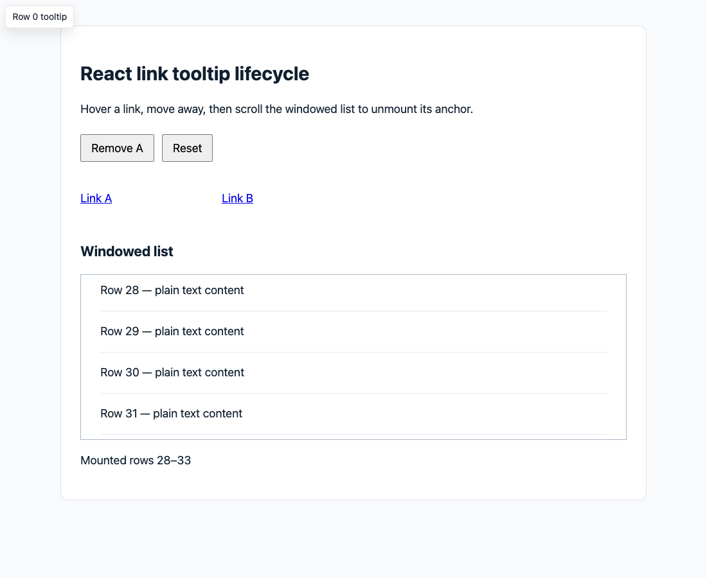
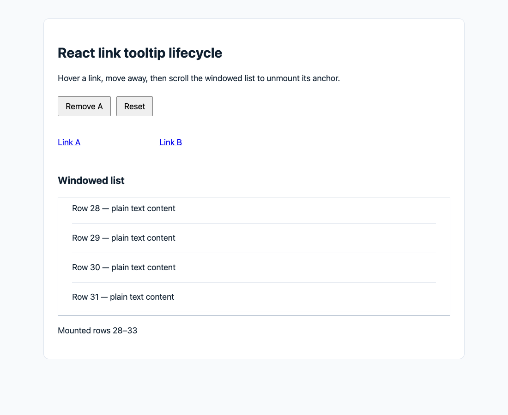
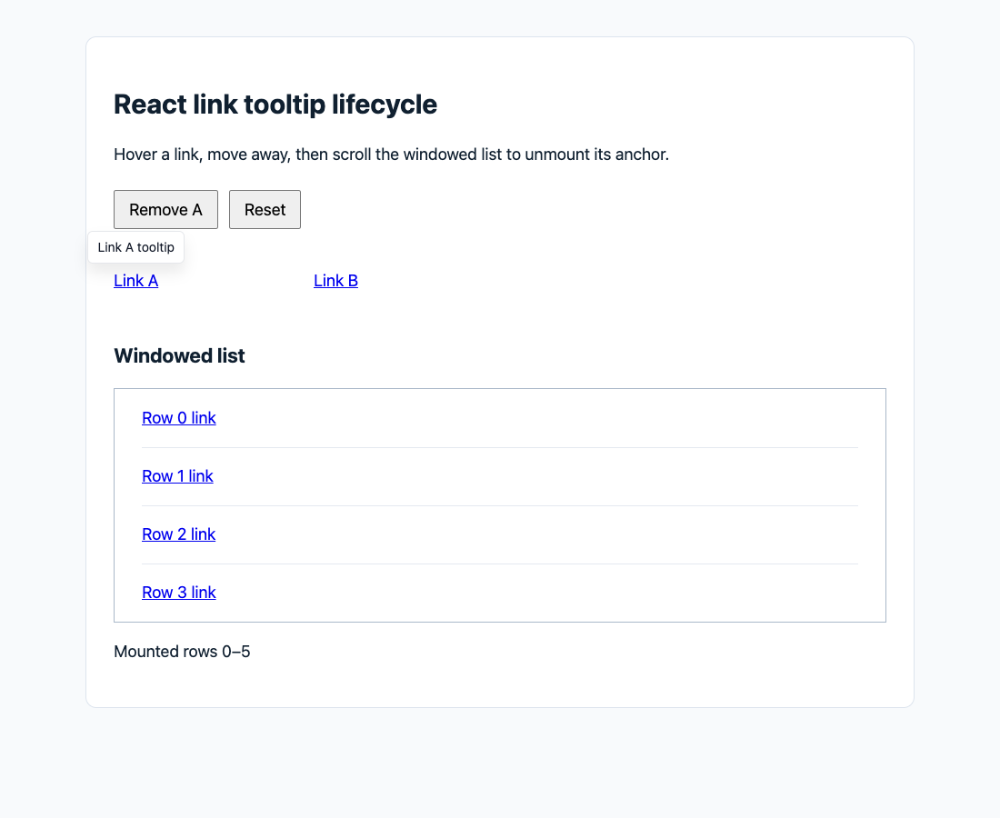
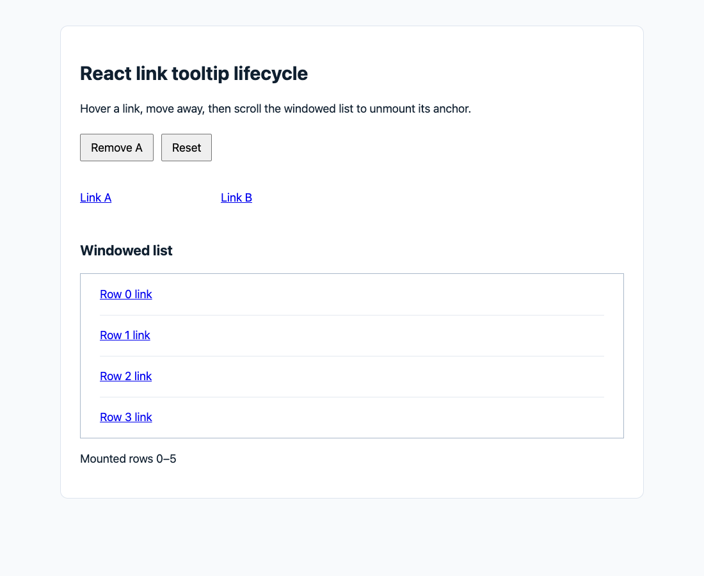

# React link tooltip race: reproduction and validation

Evidence for `fix(react): cancel stale link tooltip requests`:

- Baseline: `Simon-He95/markstream-vue@af4d195e3de653af0e962727d36385a9caea9fc2` (`markstream-react@2.0.19`).
- Fix: `13Cohen/markstream-vue@8d0aeffe2aff080a4332624cb464669cb5508528`.
- Source diff: only `packages/markstream-react/src/tooltip/singletonTooltip.ts`, `packages/markstream-react/src/components/LinkNode/LinkNode.tsx`, and `test/react-singleton-tooltip.test.tsx`.
- Recorded on 2026-10-17 with Node 22.22.3, pnpm 10.34.5, Playwright Core 1.62.0, Chrome 155.0.8059.82. Root React: 19.2.8; React 18 playground: 18.3.1.
- This independent evidence branch contains no changes to the source PR. Source/file hashes and evidence hashes are in [manifest.json](./manifest.json). Original baseline source snapshots are included under the repository's MIT license.

## Trigger, root cause, and expected behavior

Hover a link and leave or unmount it while the delayed show/positioning is pending. On the baseline, the old promise can make the singleton visible again and register `autoUpdate` for an obsolete anchor. Switching from A to B also leaves A's `aria-describedby` behind. A separate lifecycle problem is that LinkNode does not release its request on unmount.

The fix invalidates old requests immediately, checks both asynchronous boundaries and anchor connectivity, and cleans up only the owning anchor. A switching or unmounting old link cannot close B's tooltip or a shared button tooltip. Existing show/hide delays are retained. Public renderer API is unchanged.

## Browser evidence and its limits

The page uses the actual library LinkNode, CSS, React events, DOM layout, and Floating UI. Its small windowed list mounts six keyed rows; scrolling genuinely unmounts old React links. Later rows are plain text so a replacement link does not legitimately show a new tooltip under the mouse. A keeps a fixed layout slot so removing A does not accidentally move B away from the mouse.

**Ordinary browser flows** use real Playwright hover/mouse movement and wheel scrolling with unmodified Floating UI timing. The queued-unmount flow immediately changes the real container's scrollTop and dispatches scroll to commit React's window update before the hover delay expires. **Controlled in-flight flows** compute the real Floating UI position, then hold only its result promise until after leave/unmount and the hide delay. These deterministic race cases are not claims about the frequency of that timing in normal browsing. The runner warms Vite's dependency optimizer before measuring scenarios.

| Scenario | Baseline | Fix |
|---|---|---|
| Normal hover → leave | pass | pass |
| Visible tooltip → wheel scroll/unmount | pass | pass |
| Hover delay → scroll/unmount | fail: visible ghost and stale aria | pass |
| Held position → leave → release | fail: tooltip reappears | pass |
| Held position → scroll/unmount → release | fail: tooltip reappears | pass |
| A → B → release A's old result | fail: A's aria remains | pass |
| Unmount A while B owns the tooltip | fail: A's aria remains | pass |

Baseline: 5 failures / 2 passes, exit 1. Fix: 7 passes, exit 0. Neither measured run reported page errors. Assertions check `data-visible`, computed opacity, detached-anchor state, and aria association. Browser coverage here is Chrome.

| Before | After |
|---|---|
|  |  |
|  |  |

Additional evidence: [A unmounts while B stays visible](./screenshots/after-a-unmount-keeps-b.png), [normal hover](./screenshots/after-normal-hover.png), [React 18 playground hover](./screenshots/react18-playground-hover.png), [React 18 playground leave](./screenshots/react18-playground-leave.png).

Machine-readable observations: [baseline browser](./results/before-browser.json), [fixed browser](./results/after-browser.json), [built React 18 playground](./results/react18-playground.json).

## Library regression and validation

The same 20 tests fail 18 times on the exact baseline source and all pass with the fix. They cover both await boundaries, hide/detach/switch microtasks, stale positioning and autoUpdate, queued/positioning/visible unmount, A→B ownership, shared buttons, loading, disabled tooltips, aria cleanup, and normal hover timing.

| Check | Result | Log |
|---|---|---|
| Baseline regression | 18 fail / 2 pass; exit 1, expected | [log](./logs/before-regression-final.log) |
| Fixed regression | 20 pass; exit 0 | [log](./logs/after-regression.log) |
| React 18.3.1 + StrictMode | 20 pass + 1 probe; exit 0 | [log](./logs/react18-strict.log) |
| `pnpm test --run` | 386 files, 3418 tests pass; exit 0 | [log](./logs/after-full-test.log) |
| `pnpm lint` | exit 0 | [log](./logs/after-lint.log) |
| `pnpm typecheck` | exit 0 | [log](./logs/after-root-typecheck.log) |
| `pnpm --filter markstream-react typecheck` | exit 0 | [log](./logs/after-react-typecheck.log) |
| `pnpm build` | parser, core, root JS/CSS/DTS; exit 0 | [log](./logs/after-root-build.log) |
| `pnpm --filter markstream-react build` | React JS/CSS/DTS; exit 0 | [log](./logs/after-react-build.log) |
| `pnpm --filter markstream-react check:exports` | 9 subpaths pass; exit 0 | [log](./logs/after-react-exports.log) |
| `pnpm run check:peer-deps` | exit 0 | [log](./logs/after-peer-deps.log) |
| `pnpm play:react18:build` | exit 0 | [log](./logs/after-react18-playground-build.log) |
| Source browser baseline / fixed | exit 1 / 0 | [before](./logs/before-browser.log), [after](./logs/after-browser.log) |
| Built React 18 playground | hover/leave pass, no page errors; exit 0 | [log](./logs/after-react18-playground-browser.log) |

The StrictMode config aliases React and ReactDOM to the actual React 18 installation and wraps the mounted regression links in StrictMode in memory. Its extra probe asserts `React.version === '18.3.1'` and that the initial effect runs twice. This supplemental check is separate from the committed root suite, which uses React 19. The full suite emits a jsdom canvas-not-implemented diagnostic but finishes with no failed tests and exit 0. Playground builds report large-chunk warnings and exit 0.

Logs retain results and exit codes; machine-specific paths are replaced with `<repo>`/`<home>`. Full validation results were reused because the reviewed source commit is unchanged. The publication layout's baseline, StrictMode and browser scripts were also smoke-checked separately.

## Reproduce

Use two sibling directories named `markstream-vue` (source) and `tooltip-evidence` (this evidence checkout). Install the repository-declared pnpm version and Chrome/Chromium first.

```sh
git clone --branch fix/react-link-tooltip-race https://github.com/13Cohen/markstream-vue.git markstream-vue
git -C markstream-vue fetch origin evidence/react-link-tooltip-race
git -C markstream-vue worktree add --detach ../tooltip-evidence FETCH_HEAD
cd markstream-vue
git checkout --detach 8d0aeffe2aff080a4332624cb464669cb5508528
pnpm install --frozen-lockfile
```

Run the final tests against the two included baseline source snapshots, then the real fixed source. The baseline config loads snapshots in memory without modifying source files:

```sh
pnpm exec vitest run test/react-singleton-tooltip.test.tsx --config ../tooltip-evidence/baseline.vite.config.mjs
# Expected: 18 failures / 2 passes, exit 1.
pnpm exec vitest run test/react-singleton-tooltip.test.tsx
# Expected: 20 passes, exit 0.
pnpm exec vitest run test/react-singleton-tooltip.test.tsx --config ../tooltip-evidence/react18-strict.config.mjs
# Expected: 21 passes (20 regressions + version/effect-replay probe), exit 0.
```

For browser baseline, start the server below, then run the runner in another terminal from the same source directory:

```sh
node ../tooltip-evidence/serve.mjs --baseline
# Second terminal:
node ../tooltip-evidence/browser.mjs before
# Expected: exit 1 (the five observed baseline failures).
```

Stop the server before switching modes; both use port 4187:

```sh
node ../tooltip-evidence/serve.mjs
# Second terminal:
node ../tooltip-evidence/browser.mjs after
# Expected: exit 0 (7/7).
```

Open `http://127.0.0.1:4187/__tooltip-repro` for manual hover and scroll. For a held-result case, set `window.__holdPosition = true` before hover in DevTools, leave or scroll, wait for the hide delay, then run:

```js
window.__holdPosition = false
window.__pendingPositions.splice(0).forEach(resolve => resolve())
```

The runner defaults to Chrome's standard macOS executable. On another platform set `PLAYWRIGHT_CHROME_PATH` to an installed Chrome/Chromium executable. Newly generated screenshots and browser JSON are written next to the runner.

To check the production React 18 playground, build React and the playground, run preview on port 4188, then run the supplied script:

```sh
pnpm --filter markstream-react build
pnpm play:react18:build
pnpm --dir playground-react18 exec vite preview --host 127.0.0.1 --port 4188 --strictPort
# Second terminal, from source directory:
node ../tooltip-evidence/playground.mjs
```
